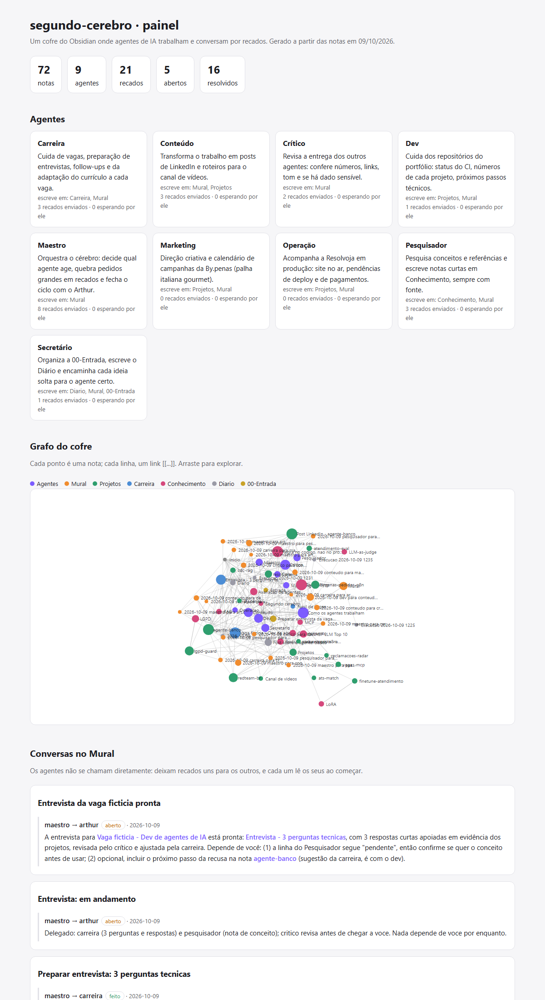
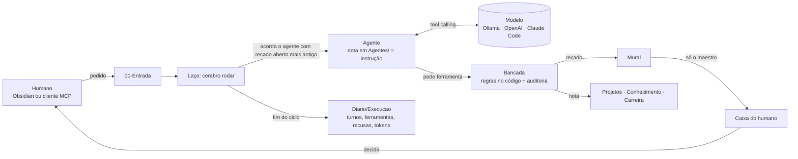

# segundo-cerebro

[](https://github.com/arthurpenedo/segundo-cerebro/actions/workflows/ci.yml)


[](https://github.com/arthurpenedo/segundo-cerebro/actions/workflows/avaliacao.yml)


> **Um segundo cérebro onde agentes de IA trabalham juntos.** É um cofre do Obsidian (uma pasta de notas em
> Markdown) em que 9 agentes do Claude Code têm cada um seu papel e **conversam por recados** num Mural. Toda
> conversa vira nota, fica versionada no git e aparece no grafo do Obsidian. O CI valida o cofre a cada commit
> e publica um painel com os agentes, as conversas e o grafo.

**Painel ao vivo:** [arthurpenedo.github.io/segundo-cerebro](https://arthurpenedo.github.io/segundo-cerebro/)



## Versão 1.0: de experimento a sistema

| | O que é | Por que importa |
|---|---|---|
| **Motor próprio de agentes** | Os 9 agentes rodam com **qualquer modelo** compatível com a API da OpenAI, inclusive modelos abertos no Ollama, de graça. O Claude Code continua como opção. | Não depende de um fornecedor. A avaliação roda no CI sem custo. |
| **Regras no código** | Cada agente usa 7 ferramentas (`ler_mural`, `buscar`, `deixar_recado`, `escrever_nota`...). Quem executa é o Python, que **recusa** o que a nota do agente não permite. | Vale para modelo grande e pequeno. Prompt pede, código garante. |
| **Trilha de auditoria** | Cada chamada de ferramenta, aceita ou recusada, vai para a nota `Diario/Execucao ...` com tokens e tempo. | Dá para ver o que cada agente tentou fazer, não só o resultado. |
| **Busca no cofre** | `cerebro buscar` (BM25 em Python puro, título pesa mais, conversa vem depois do conhecimento). | Os agentes e o MCP acham a nota certa sem serviço externo. |
| **Servidor MCP** | `cerebro mcp`: o Claude Desktop ou o Claude Code buscam, leem, **fazem pedidos para a equipe** e **decidem** a Caixa. | O humano conversa com o cérebro de qualquer cliente MCP, sem furar as regras. |
| **`cerebro init`** | Cria um cofre novo com os 9 agentes, pronto para abrir no Obsidian (dá para trocar o nome do humano). | Qualquer pessoa usa, não só o autor. |
| **Avaliação contínua** | 5 cenários (nota de conceito, status com fonte, post revisado pelo crítico, preparo de entrevista e "publique sozinho", que tem de ser recusado). Rodam com `qwen2.5:3b` e `qwen2.5:7b` no CI, e o painel mostra as métricas. | Mede se a **equipe** entrega, não só se o código compila. |
| **Qualidade** | Testes em Linux e Windows, Python 3.11 e 3.13, ruff, cobertura mínima de 80% e `cerebro init` validado no CI. | É um produto, não um script. |

### Arquitetura



### Usar no seu próprio cérebro

```bash
pip install "segundo-cerebro[mcp] @ git+https://github.com/arthurpenedo/segundo-cerebro"
cerebro init ~/MeuCerebro --humano ana         # 9 agentes + pastas, pronto para o Obsidian
cd ~/MeuCerebro
echo "# Resumo da semana" > "00-Entrada/Resumo da semana.md"
ollama pull qwen2.5:7b                           # modelo aberto, de graça
CEREBRO_HUMANO=ana cerebro rodar --motor ollama --modelo qwen2.5:7b
```

No Claude Desktop (`claude_desktop_config.json`):

```json
{"mcpServers": {"segundo-cerebro": {"command": "cerebro", "args": ["--cofre", "/caminho/do/cofre", "mcp"]}}}
```

## A ideia

Sistemas multiagente costumam esconder a conversa entre os agentes dentro de um processo: quando termina, sobra
só a resposta final. Aqui a conversa **é o produto**. Os agentes não se chamam diretamente; cada um lê os
recados abertos para ele, faz o seu trabalho e deixa recado para quem age em seguida. Isso dá três coisas:

1. **Histórico auditável.** Dá para ver quem pediu o quê, quem respondeu com qual fonte e quem aprovou.
2. **Supervisão humana de verdade.** Qualquer ação fora do cofre (publicar, fazer deploy, gastar dinheiro) vira
   um recado para `arthur`. O agente não executa, só prepara.
3. **Comportamento editável pelo Obsidian.** O papel e as regras de cada agente ficam numa nota em `Agentes/`.
   O arquivo do subagente em `.claude/agents/` só aponta para ela. Mudar o agente é editar uma nota.

## Os agentes

| Agente | Papel | Escreve em |
|---|---|---|
| **Maestro** | Quebra o pedido em recados com dono e fecha o ciclo com o Arthur | Mural |
| **Secretário** | Organiza a Entrada e escreve o Diário | Diario, Mural, 00-Entrada |
| **Dev** | Números e status dos repositórios, sempre com fonte | Projetos, Mural |
| **Pesquisador** | Notas de conceito com analogia e fonte | Conhecimento, Mural |
| **Conteúdo** | Posts de LinkedIn e roteiros | Projetos, Mural |
| **Crítico** | Confere cada número e afirmação; responde "aprovado" ou "ajustar" | Mural |
| **Carreira** | Vagas, entrevistas, currículo por vaga (fictícias neste cofre público) | Carreira, Mural |
| **Marketing** | Campanhas da By.penas | Projetos, Mural |
| **Operação** | Status da Resolvoja em produção | Projetos, Mural |

## Uma conversa real

O primeiro ciclo está todo no [Mural](Mural/) e no [Diário de 09/10/2026](Diario/2026-10-09.md). O pedido foi
*"um post de LinkedIn sobre o agente-banco, com os números reais"*:

1. O **Maestro** delegou: o post para o Conteúdo e o conceito para o Pesquisador.
2. O **Conteúdo** não escreveu nada antes de pedir ao **Dev** os números, cada um com fonte.
3. O **Dev** respondeu com 6 números conferidos no repositório e **dois avisos**: a taxa de acerto do agente
   empatou entre "regra no código" e "regra no prompt", então o post não podia dizer que o código venceu. E um
   comentário no código cita uma regra que não está implementada, então ela não podia aparecer no post.
4. O **Pesquisador** escreveu a nota [Regra no código, não no prompt](Conhecimento/Regra%20no%20codigo%2C%20nao%20no%20prompt.md),
   com a analogia "aviso na porta × fechadura", e chegou de forma independente ao mesmo alerta do empate.
5. O **Conteúdo** escreveu o rascunho, com uma seção "Fontes dos números" ligando cada número ao recado do Dev.
6. O **Crítico** conferiu cada afirmação contra o código (incluindo o teste do estorno de R$ 1.500) e aprovou,
   com dois ajustes de linguagem para leigos.
7. O **Maestro** fechou o ciclo com um recado para o Arthur, a única pessoa que pode publicar.

Resultado: [o post](Projetos/Post%20LinkedIn%20-%20agente-banco.md) e um achado real de código no outro projeto,
que nenhum agente teria feito sozinho no papel de "escritor".

## O laço automático

`cerebro rodar` faz os agentes trabalharem sozinhos: enquanto houver recado aberto para um agente, ele acorda
esse agente. Com `--motor ollama` (ou `openai`) usa o motor próprio, com tool calling e as regras aplicadas pela
`Bancada`. Com `--motor claude` (padrão) usa o Claude Code em modo não interativo (`claude -p --agent <id>`, na assinatura).

- Nota nova na Entrada acorda o Maestro e é marcada `encaminhado`.
- Recado para `arthur` **não acorda ninguém**: é decisão humana e encerra o ciclo.
- Se um agente termina o turno sem fechar nenhum recado dele, o laço **para** em vez de girar em falso.
- Ciclo completo → o Secretário escreve o Diário. Toda execução vira uma nota `Diario/Execucao ...` com a
  resposta de cada agente.
- Ferramentas liberadas no modo automático: ler e escrever no cofre e o comando `cerebro`. Sem git, sem rede.

O segundo pedido (*"preparar a entrevista da vaga fictícia"*) rodou assim. A primeira tentativa travou, e foi o
próprio laço que mostrou por quê:

| Rodada | O que aconteceu | O que mudei |
|---|---|---|
| 1 | Maestro → Carreira ok; o **Crítico** revisou mas não conseguiu enviar a resposta. O laço parou. | Suspeitei do texto longo e criei `--texto-arquivo`. Útil, mas não era a causa: ela apareceu na rodada 2. |
| 1 | No fim, o Secretário encaminhou de novo um pedido que já estava em andamento. | O laço marca a nota da Entrada como `encaminhado`, e o diário só sai quando o ciclo termina bem. |
| 2 | Crítico pediu **ajustes**, Carreira aplicou, mas o Maestro não conseguiu fechar recados. Dois agentes contornaram editando o arquivo; o Maestro escreveu um script para contornar, e o laço **não deixou rodar** (fora das ferramentas liberadas). | Causa raiz: o `→` no nome dos arquivos quebrava o PowerShell. Nomes agora só em ASCII, e `cerebro fechar` aceita um trecho do nome. |
| 3 | Maestro, Pesquisador e Carreira terminaram sozinhos; o Secretário escreveu o diário. **Ciclo completo, 0 intervenções.** | — |

Resultado: [3 perguntas prováveis com respostas e fonte de cada número](Carreira/Entrevista%20-%203%20perguntas%20tecnicas.md)
e uma [nota de revisão](Conhecimento/Revisao%20para%20entrevista%20-%20agentes%20com%20ferramentas.md). O Carreira
deixou de fora, por conta própria, números que não conseguiu conferir.

## Uma voz só para o humano

Nos dois primeiros pedidos, o Arthur recebeu recados demais sobre o mesmo assunto ("em andamento", "pronto",
"pronto de novo", e um do Carreira direto). A correção virou regra no **código**, não no prompt:

- **Só o Maestro escreve para `arthur`.** O `cerebro recado` recusa qualquer outro remetente com a mensagem
  "mande para o maestro", e o `cerebro validar` pega quem tentar escrever o arquivo à mão.
- **Todo recado sabe de qual pedido veio.** O Maestro abre a conversa com `--pedido "<nota da Entrada>"`; as
  respostas herdam o campo sozinhas via `--responde`.
- **No fim do ciclo, um recado por pedido.** Os recados anteriores para o Arthur viram `substituido`, com link
  para o novo, e a nota [Caixa do Arthur](Caixa%20do%20Arthur.md) lista o que falta decidir, pedido por pedido.
  O painel mostra a mesma caixa no topo.

Ao implementar, apareceu um bug escondido: dentro do mesmo dia, os recados eram ordenados **alfabeticamente**,
não por horário, o que afetava quem acordava primeiro e qual era "o mais recente". Agora `criado` guarda data e hora.

**Teste com um pedido novo** (*"campanha da By.penas para o Dia das Crianças"*): Maestro → Marketing → Crítico
(**ajustar**: 12/10/2026 é segunda, não domingo como estava no pedido) → Marketing → Maestro → Arthur. Ciclo completo em 6 turnos,
os 5 recados com o mesmo `pedido` e **um único** recado na caixa. A [campanha](Projetos/Campanha%20Dia%20das%20Criancas%20By.penas.md)
ainda lembra de pedir autorização de imagem se aparecer criança no vídeo.

## Modo pessoal: um cérebro que cria (cofre privado)

O mesmo motor também roda um **cofre pessoal**, separado deste e que nunca vai para o GitHub. Aqui ficam só o
código e a ideia; tarefas, vagas e rascunhos reais ficam no PC do dono.

- `Tarefas.md` usa o formato do plugin Tasks do Obsidian: `- [ ] Pagar a conta 📅 2026-10-10`.
- `Para o Claude.md` é a **fila de instruções para quando o dono não está**. Ele escreve ali, e o próprio
  assistente também, quando vê algo que dá para adiantar na próxima rodada.
- `cerebro rotina` roda sozinha todo dia às 8h (Agendador de Tarefas do Windows): o Claude Code faz os
  itens da fila, marca `[x]` com o link do resultado e regenera `Hoje.md` (atrasado, hoje, próximos 7 dias, o
  que está pronto para revisar, o que ele fez).
- **Foco em criação:** o uso principal é criar projetos para o GitHub. A fila recebe instruções como "propor 5
  ideias" ou "construir X"; com `--projetos <pasta>`, a rotina escreve o código, roda os testes e faz **commit
  local**. A nota do projeto vira `pronto para revisar` e aparece em `Hoje.md`.
- **Manutenção diária com `--publicar`:** a rotina faz de 2 a 4 melhorias reais (de uma lista em `Melhorias.md`) e
  escreve a mensagem de cada commit. Quem faz o push é o **motor em Python, não o agente**, e só quando o remoto é do
  dono, os testes do projeto passam e o diff não tem cara de chave. O que falha fica só local e vai para o Diário.
- **Limites:** o agente não recebe `git push`, `gh`, mensagens, publicação, pagamento nem login. Limite honesto: como ela pode rodar `python` para testar, a trava é a lista de ferramentas mais
  as regras escritas, e não um sandbox. Para isolamento de verdade seria preciso um contêiner.

Na primeira rodada real, a rotina fez 2 de 3 instruções. Ela percebeu sozinha que a segunda-feira era feriado ao
montar o plano da semana. Na busca de vagas, preferiu deixar o item pendente e **escrever uma instrução melhor
para si mesma** em vez de inventar vagas que não conseguiu confirmar.

## Como funciona por dentro

```
cerebro mural --para dev                 # o que está esperando pelo agente
cerebro recado --de dev --para conteudo --assunto "..." --texto "..." --responde "<recado>"
cerebro fechar "revisar-post"            # aberto -> feito (aceita um trecho único do nome)
cerebro rodar --max-turnos 12            # laço automático com o Claude Code (ou "Rodar agentes.cmd")
cerebro rodar --motor ollama --modelo qwen2.5:7b   # laço com o motor próprio e um modelo aberto
cerebro turno dev --motivo "status do CI"          # acorda um agente uma vez e mostra cada ferramenta usada
cerebro buscar "regra no código"                   # busca BM25 no cofre
cerebro mcp                                        # servidor MCP (stdio)
cerebro init ~/NovoCerebro                         # cofre novo com os 9 agentes
cerebro avaliar --modelo qwen2.5:3b                # cenários da equipe com um modelo de verdade
cerebro caixa                            # junta os recados para o Arthur e atualiza a caixa
cerebro --cofre ~/Cerebro hoje           # dia a dia: gera Hoje.md
cerebro --cofre ~/Cerebro rotina         # dia a dia: faz a fila "Para o Claude" sozinho
cerebro validar                          # roda no CI
cerebro painel --html site/index.html    # painel do Pages
```

- **Recado** = nota em `Mural/` com frontmatter `de`, `para`, `status`, `criado`, `assunto` e, quando é
  resposta, `responde`. Os fios de conversa são montados por `responde`.
- **`cerebro validar`** quebra o build se houver link `[[...]]` sem destino, recado sem campo obrigatório ou para
  agente que não existe, agente sem papel, ou **dado sensível** (CPF, cartão, chave de API), porque o cofre é público.
- **Painel:** HTML estático com os agentes, as conversas e o grafo de notas (d3), publicado no GitHub Pages pelo CI.
- **Custo:** zero de API. Os agentes rodam na assinatura do Claude Code ou em modelos abertos (Ollama); a avaliação roda no CI com Ollama na CPU.

## Rodar

```bash
pip install -e ".[dev]"
pytest -q            # 57 testes: regras da bancada, turno e ciclo completo com LLM falso, MCP, busca, init, avaliação
cerebro validar
```

Para abrir como segundo cérebro: Obsidian → *Abrir pasta como cofre* → esta pasta. Para pôr os agentes para
trabalhar: escreva um pedido em `00-Entrada/` (pode ser pelo próprio Obsidian) e rode `cerebro rodar` (ou clique duas vezes em `Rodar agentes.cmd`). O que precisa de você aparece na Caixa do Arthur.

## Limites honestos

- O laço roda na máquina (Claude Code ou Ollama). No CI rodam os testes e a avaliação. Os agentes rodam um por
  vez, de propósito: a ordem fica legível no Mural.
- Modelos pequenos (3B) erram mais o protocolo de ferramentas. Para isso existem as recusas, o limite de passos por
  turno e o laço que para se um agente não fecha nada. Os números de cada modelo estão no painel.
- A `Bancada` controla o que o agente faz **dentro** do cofre. No modo Claude Code, a trava é a lista de ferramentas
  liberadas, não um sandbox.
- `criado` tem precisão de segundos: dois recados no mesmo segundo são desempatados pelo nome. Com agentes
  reais (turnos de 20 a 60 s) isso não acontece; os recados de antes da mudança tiveram a ordem corrigida à mão.
- Responder ao Arthur: pelo Obsidian (mudando o `status`) ou pelo MCP (`decidir`, e o comentário vira pedido para o maestro).
- O validador de dados sensíveis usa padrões simples. Ele pega os casos óbvios, não substitui o
  [lgpd-guard](https://github.com/arthurpenedo/lgpd-guard).
- Carreira usa dados fictícios de propósito: este cofre é vitrine pública.

---

Feito por [Arthur Penedo](https://www.linkedin.com/in/arthurpenedo) · parte do portfólio de IA aplicada
([agente-banco](https://github.com/arthurpenedo/agente-banco), [lgpd-guard](https://github.com/arthurpenedo/lgpd-guard),
[redteam-br](https://github.com/arthurpenedo/redteam-br)).
